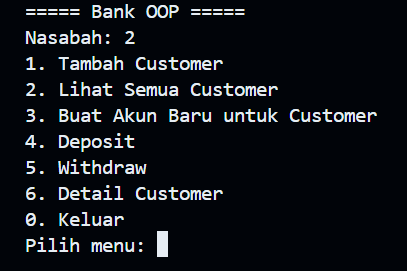
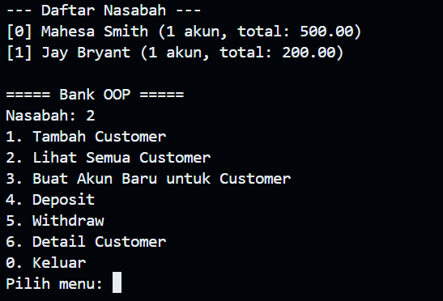
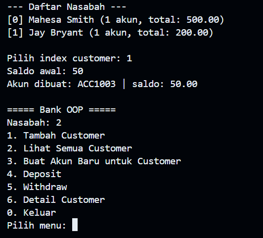
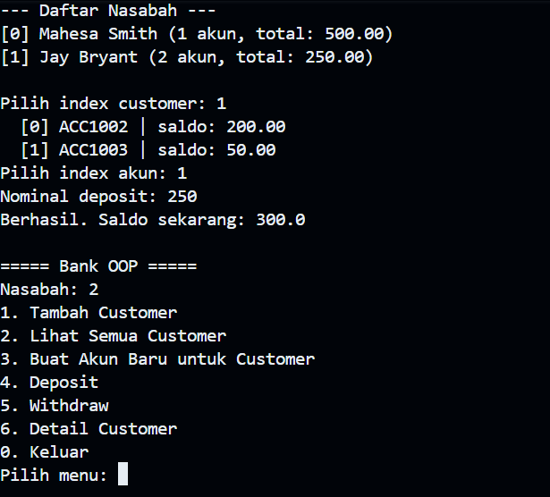
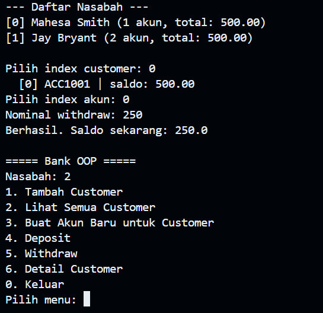
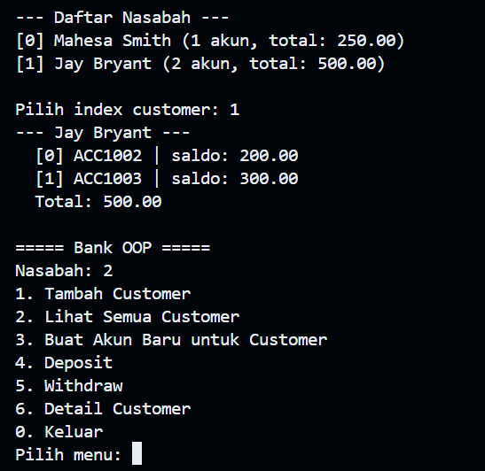

Nama : I Kadek Mahesa Permana Putra
NIM  : F1D02410052

Struktur:

```
bank/
  src/  -> Account.java, Customer.java, Bank.java, Main.java
  bin/  -> hasil .class
  img/  -> screenshot demo program
```

## Konsep: Objects (Arrays) + Methods

* `Bank` menyimpan `ArrayList<Customer> customers`
  * `new Bank("Bank OOP")` → buat objek Bank
  * `bank.addCustomer("Mahesa", "Smith")` → buat + simpan objek Customer ke array
  * `bank.getCustomer(i)`, `bank.getNumOfCustomers()`, `bank.getCustomers()` → akses array
* `Customer` menyimpan `ArrayList<Account> accounts`
  * `new Customer(f, l)` (dipanggil di dalam `addCustomer`)
  * `customer.addAccount(new Account(500.00))` → buat + simpan objek Account ke array
  * `customer.getAccount(i)`, `customer.getNumOfAccounts()`, `customer.getTotalBalance()` → akses array
* `Account` = objek tunggal dengan method `deposit(amt)`, `withdraw(amt)`, `getBalance()`

## Compile

Dari dalam folder `bank/`:

```powershell
javac -d bin src/*.java
```

## Run

Dari dalam folder `bank/`:

```powershell
java -cp bin Main
```

## Demo Program

### 1. Menu Utama



Main menu: tambah customer, lihat semua customer, buat akun, deposit, withdraw, detail customer.

### 2. Lihat Semua Customer (Menu 2)



Menampilkan seluruh daftar nasabah dari Array of Object yang terdaftar

### 3. Buat Akun Baru (Menu 3)



Pilih index customer → `bank.getCustomer(ci)` → `new Account(init)` → `customer.addAccount(acc)`. Di sini customer Jay (index 1) dibuatkan akun kedua `ACC1003` dengan saldo 50.00.

### 4. Deposit (Menu 4)



Pilih customer → pilih index akun → `acc.deposit(amt)`. Di sini akun `[1]` Jay di-deposit 250 sehingga saldo 50.00 → 300.00.

### 5. Withdraw (Menu 5)



Pilih customer → pilih index akun → `acc.withdraw(amt)`. Di sini akun `[0]` Mahesa di-withdraw 250 sehingga saldo 500.00 → 250.00.

### 6. Detail Customer (Menu 6)



Loop array `accounts` dengan `getNumOfAccounts()` + `getAccount(i)` + `getTotalBalance()`. Di sini Jay Bryant punya 2 akun (200.00 + 300.00 = total 500.00).

